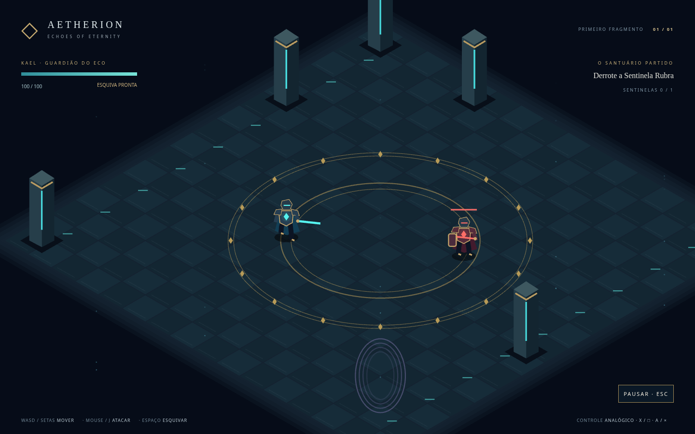

# AETHERION — Echoes of Eternity

Primeira arena de um RPG de ação isométrico, com arte inteiramente vetorial/procedural. TypeScript, PixiJS e Vite. Kael enfrenta uma Sentinela Rubra e ativa o portal do Santuário Partido.

## Executar (incluindo Fedora Linux)

Instale Node.js 24 LTS e npm. No checkout:

```sh
npm ci
npm run dev
```

Abra o endereço exibido pelo Vite no navegador. É preciso WebGL com aceleração gráfica. Não é necessário Steam ou Electron. O build estático pode ser servido por HTTP, inclusive em subdiretórios:

```sh
npm run build
npm run preview
```

WASD/setas: movimento; mouse: direção; clique esquerdo/J: ataque; espaço: esquiva; Esc: pausa. No controle: analógico esquerdo move, direito aponta, X/□ ataca, A/× esquiva e Start pausa. D-pad percorre menu, A confirma. Fuja do círculo vermelho antes do ataque; após derrotar a Sentinela, entre no portal a sudeste. O marco salvo restaura a vitória sobre o inimigo, com vida cheia.

## Validar

```sh
npm test
npm run build
npx playwright install --with-deps chromium firefox
npm run test:e2e
```

Em Fedora, instale as bibliotecas exigidas pelo Playwright conforme os diagnósticos da ferramenta; o instalador `--with-deps` é voltado a distribuições suportadas. Para um Chromium do sistema, use `PLAYWRIGHT_CHROMIUM_EXECUTABLE_PATH=/usr/bin/chromium npm run test:e2e -- --project=chromium`. Isso não valida Firefox.

## Escopo e documentação

Arena curta, uma classe de inimigo, ataque básico, esquiva, vida/morte, menu, pausa, configurações, áudio sintetizado e checkpoint local. Não representa ainda o jogo comercial completo. Sem sprites raster, imagens remotas, conta online ou compras.

- [Arquitetura e limites](docs/ARCHITECTURE.md)
- [Direção de arte](docs/ART_DIRECTION.md)
- [Regras da arena](docs/GAME_DESIGN.md)
- [Desktop, pipelines futuros e Steamworks](docs/DESKTOP_STEAM.md)
- [Roadmap](docs/ROADMAP.md)
- [Resultados de teste](docs/TEST_REPORT.md)

Electron/Steamworks e builds Windows/Linux são futuros e ainda não validados. Nenhum build será publicado na Steam nem pagamento será feito sem autorização explícita.


